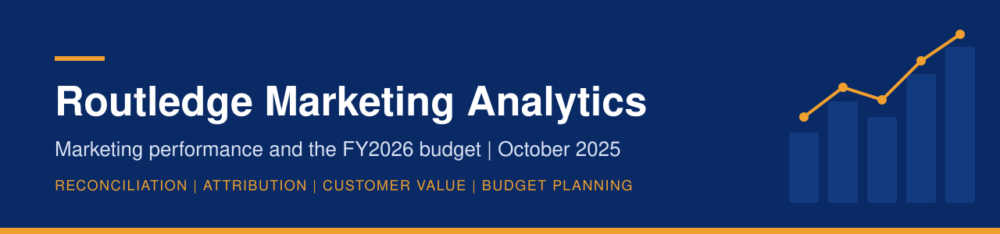
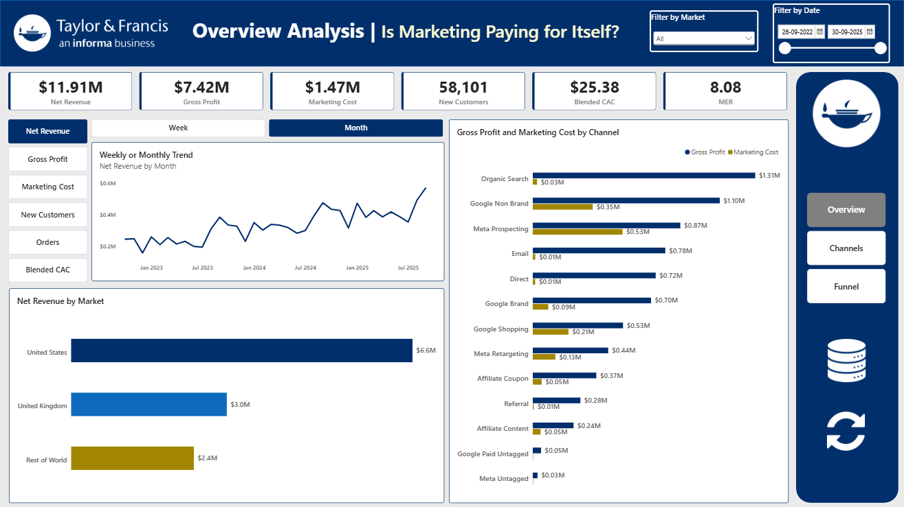
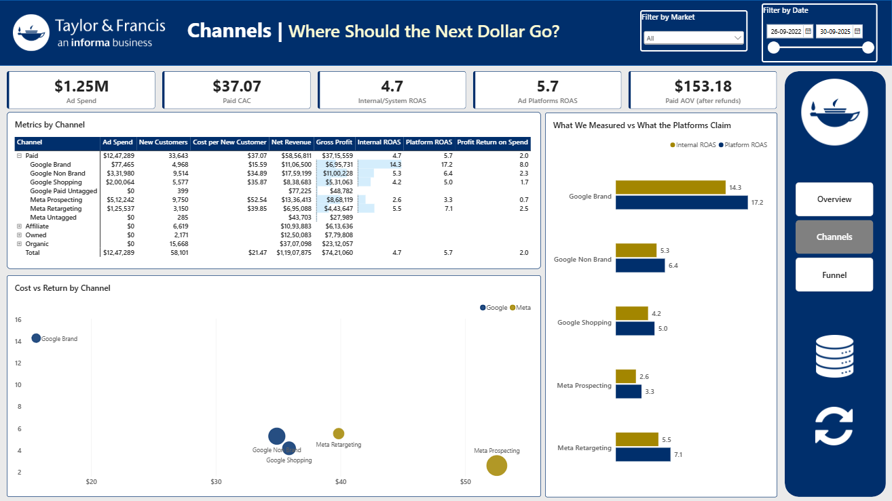
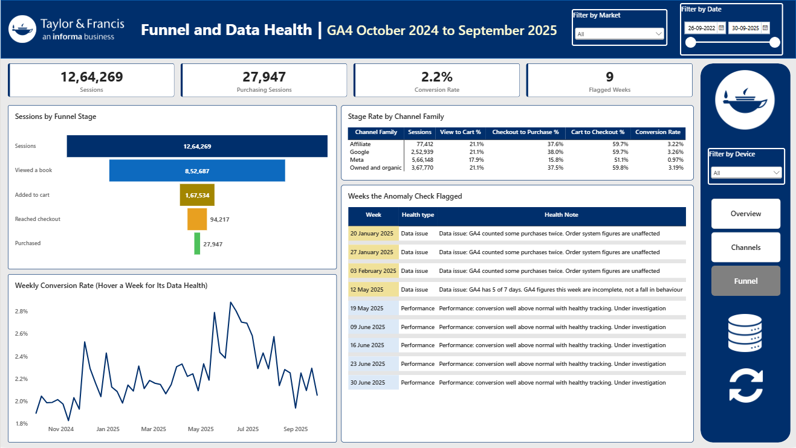

<p align="center">
  
</p>

<p align="center">
  
  
  
  
  
  
  
</p>

<p align="center">
  <a href="docs/Routledge_Marketing_Report.pdf"><strong>Read the full report (PDF)</strong></a>
</p>

---

## Table of contents

1. [Project overview](#project-overview)
2. [Business context and problem statement](#business-context-and-problem-statement)
3. [Data overview](#data-overview)
4. [Tools and technologies](#tools-and-technologies)
5. [Approach](#approach)
6. [Notes on the numbers](#notes-on-the-numbers)
7. [Key insights](#key-insights)
8. [Recommendations](#recommendations)
9. [Dashboard preview](#dashboard-preview)
10. [Limitations](#limitations)
11. [Repository structure](#repository-structure)
12. [How to reproduce](#how-to-reproduce)
13. [Author](#author)

---

## Project overview

Marketing analytics for Routledge's direct to consumer bookshop at routledge.com, covering 1 October 2022 to 30 September 2025. The work reconciles what the ad platforms claim with what actually sold, measures what each channel and partner earns in gross profit, sizes customer value and the CRM programme, and turns it into the FY2026 paid media budget.

**The business context is real; the data is simulated.** No figure here describes actual Taylor & Francis performance.

## Business context and problem statement

It is October 2025 and the FY2026 marketing budget is being set (the financial year runs October to September, so FY2025 is 1 October 2024 to 30 September 2025). Leadership does not trust the numbers coming out of Google and Meta, suspects some channels and partners take credit for sales that would have happened anyway, and wants the budget built on profit rather than reported revenue. That breaks into five questions:

1. Can we trust our numbers, and which one should be used for which decision?
2. How is each channel performing on revenue and profit, including brand against non brand search?
3. Which channels bring valuable customers, how fast do they pay back, and how should CRM win their second order?
4. Which channels and partners create sales that would not have happened anyway?
5. How should the FY2026 budget be split?

## Data overview

Three years of data, 1 October 2022 to 30 September 2025, in ten raw tables: orders (76,058), order lines, customer accounts (58,432), refunds, Google Ads and Meta Ads by day, affiliate network transactions (17,369), the sales calendar, daily exchange rates, and the GA4 export (6,009,850 events, October 2024 to September 2025 only). Every figure is reported in US dollars. FY2025 runs from 1 October 2024 to 30 September 2025, the year GA4 covers.

### Three years in numbers

| Measure | Value |
| --- | --- |
| Orders | 75,918 |
| Customers, after merging duplicate accounts | 58,101 |
| Net revenue, after discounts and refunds | $11,907,875 |
| Gross profit | $7,421,060 (62.3% of net revenue) |
| Marketing cost (ad spend plus affiliate commission) | $1,474,625 |
| MER | 8.08 |
| AOV, after refunds | $156.85 |
| 12 month repeat rate | 19.6% |

## Tools and technologies

| Tool | What it was used for |
| --- | --- |
| BigQuery and SQL | Loading and auditing the raw data, the clean layer, and the reporting, customer and attribution tables (six SQL files) |
| Python on Google Colab | Customer value, unit economics, the reconciliation walk, attribution rules and the statistical tests (two notebooks; pandas, scipy, statsmodels, matplotlib) |
| Power BI | The four page dashboard |
| Excel and Google Sheets | The FY2026 budget planner and the data issues log |

## Approach

```
Parquet files  ->  BigQuery raw: 10 tables as delivered, no value ever changed
                     |
                     v
                   BigQuery clean: every fix applied once
                   (test orders removed, duplicate accounts merged, channels mapped,
                    spend converted to dollars, GA4 flattened into sessions)
                     |
                     v
                   Reporting tables: channel_daily, funnel_daily, campaign_weekly,
                   weekly_health, customer_value, platform_weekly,
                   journey_touches, order_journeys, affiliate_transactions
                     |
                     v
   Power BI dashboard  |  Python notebooks (write unit_economics)  |  CRM plan  |  FY2026 budget planner
```

**Data audit first.** Before any analysis, every source was audited. The data issues log holds 29 findings, each sized and with a decision, and 53 checks, each with its result. The main ones: 140 staff test orders removed, 318 duplicate account pairs merged, channel tags standardised into 13 channels, ad spend converted from each account's billing currency, two missing GA4 days and three weeks of repeated purchase events found and worked around, and GA4 recording about 12% fewer orders than the order system.

## Notes on the numbers

**How the numbers are defined.** Net revenue is after discounts and refunds; gross profit is before ad spend; a customer is a person after duplicate accounts are merged; orders are credited by last click unless stated; repeat rate is the share of new customers who order again within 12 months. Every metric is defined in full in the data dictionary.

## Key insights

**The platforms over-claim, and every step can be sized.** Over the 51 complete weeks of FY2025, Google and Meta claimed 21,101 orders and 15,280 happened. Meta's view through purchases (2,350) are part of the gap. The rest fits inside what the click windows allow: orders unpaid channels won with a platform click inside the window (2,670) and double counting between the two platforms (801). Budgets use internal ROAS from the order system (4.83 for those weeks), not the 5.83 the platforms report.

**Last click flatters the channels that close.** Under position based attribution in FY2025, Google Brand's ROAS falls from 14.80 to 8.66 and Meta Retargeting's from 6.14 to 3.15, while Meta Prospecting's rises from 2.68 to 4.14. 84.0% of the orders brand search closes began on another channel.

**Every channel with a cost pays back on the first order,** so the budget question is incrementality, not payback. The data holds no holdout or experiment on any channel, so incrementality is tested as an assumption (30, 50 and 80% genuinely new customers) against each channel's break even share: 11.0% for Google Brand, 57.1% for Meta Prospecting.

**Customers come back for a later term, not the next month.** 77.6% have bought once. Only 0.63% buy again in the month after a first order; returns peak at 2.35% in month 8. Repeat rate runs from 29.8% for referral customers to 2.5% for coupon partner customers.

**Coupon partners are mostly paid on orders other channels won.** 71.1% of coupon commission sits on those orders. On the ones GA4 saw, the buying session had already started before the coupon click 94.8% of the time, against 10.8% on orders credited to coupon partners.

**Meta Prospecting visitors reach checkout and then do not buy.** On the dashboard's Funnel page, Meta visitors who reach checkout buy 15.8% of the time, against 37.5 to 38.0% for every other channel family, and Meta Prospecting visitors only about 13%. It does not look like the in-app browser, a broken release or tracking.

## Recommendations

| Recommendation | What it is worth | Confidence |
| --- | --- | --- |
| Pay coupon partners only on orders credited to them (Pay on credit), and hold commission for 45 days, dropping it if the order is refunded within the 45 days (Refund hold) | $44,202 a year ($132,607 over the last three years) | High on the amount |
| Move a fifth of Meta Retargeting's budget ($10,945) to Google Non Brand, total paid media held at $498,948 | Against repeating FY2025's budgets, -$6,844 of gross profit after ad spend under last click and +$24,388 under position based. The planner's totals, +$37,359 and +$68,590, include the commission saving in the row above | Medium |
| No extra budget for Meta Prospecting until its checkout drop off is explained | Lifting its checkout to purchase rate from about 13% to 20% would give about 1.5 times the orders | High that no increase is warranted |
| Pause UK brand search for 8 weeks as the first holdout test | Saves $1,209; brand search must protect 10.8% of its $11,182 of credited gross profit to be worth it | Simple design; the answer is unknown until it runs |
| Aim CRM at the second order, timed to the term, with a 20% holdout on every programme | Each point of twelve month repeat is about 110 more repeat customers a year, about $13,500 of gross profit | Medium, measured by the holdout |

## Dashboard preview

Four pages in Power BI, built on the clean tables in BigQuery, with market and date slicers synced across pages, a metric switcher, a week and month toggle, drill through from a channel to its campaigns, and data health tooltips on the weekly conversion chart.

**Overview: is marketing paying for itself?**



**Channels: where should the next dollar go?**



**Campaign detail, reached by drilling through from a channel**


**Funnel and data health**



## Limitations

- **Incrementality is not measured.** The data holds no holdout or experiment on any channel, so incremental ROAS is not reported. The planner tests assumed shares against break even, and the UK brand search holdout is the first measurement.
- **Diminishing returns could not be estimated.** The planner scales returns with spend and flags any budget moved more than 25% from FY2025.
- **No sale is called incremental:** the weeks either side of a sale are different points in the academic calendar, so sales are judged on discount cost and customer value only.
- **No email cost data,** and no person level email data.
- **GA4 covers one year** (October 2024 to September 2025), is about 12% short of real orders, is missing two days in May 2025, and records event times inside a session on a fixed schedule, so time to checkout is not measured. Attribution runs on the 27,905 orders GA4 saw.
- **Platforms report on different time zones,** so they are compared weekly.
- **Affiliate partner ids do not match the source tags,** so affiliates are compared by partner type only.
- **Open questions:** why Meta Prospecting visitors abandon checkout, what caused five high conversion weeks in May and June 2025, and why customers who first bought on a sale day without the code are worth more than the other two first order groups.

The full list of limitations and assumptions is in the report.

## Repository structure

```
README.md
assets/      the banner image
data/        the raw data as Parquet files
sql/         01 to 06, numbered in run order
notebooks/   01 and 02, with their outputs and charts
powerbi/     routledge_bi.pbix and the four page screenshots
docs/        report, data dictionary, data issues log, tracking plan,
             CRM lifecycle plan, FY2026 budget planner
```

| File | What it does |
| --- | --- |
| `sql/01_load_and_checks.sql` | Row counts, date ranges, keys, joins and money checks on every raw table |
| `sql/02_data_audit.sql` | The audit behind the data issues log |
| `sql/03_clean_layer.sql` | The six clean tables: channel map, accounts to people, customers, orders, ad spend in dollars, GA4 sessions |
| `sql/04_reporting_tables.sql` | Channel by day, funnel by day, campaigns by week, the weekly tracking health check, and the Meta checkout and Meta Prospecting cost per click queries |
| `sql/05_customer_value.sql` | One row per customer: first order, acquisition channel, sale group, 12 month value, RFM scores and lifecycle stage |
| `sql/06_reconciliation_attribution.sql` | Platform claims by week, customer journeys under four attribution rules, affiliate transactions |
| `notebooks/01_customer_value.ipynb` | Retention, repeat rate, 12 month value, CAC, LTV to CAC, payback, sale acquired customers, lifecycle stages, CRM audiences; writes `unit_economics` |
| `notebooks/02_reconciliation_attribution.ipynb` | The reconciliation waterfall, ROAS by data source, four attribution rules with bootstrap tests, brand search, coupon against content partners, commission terms |
| `docs/Routledge_Marketing_Report.pdf` | The full report |
| `docs/Routledge_Data_Dictionary.pdf` | Every table and column, with the traps to avoid |
| `docs/Data_Issues_Log.xlsx` | Every data problem found, its size and what was done |
| `docs/Tracking_Plan.pdf` | The GA4 events, tag rules and weekly checks that would stop the problems at source |
| `docs/CRM_Lifecycle_Plan.pdf` | What CRM sends each lifecycle stage, when, and how it is measured |
| `docs/Routledge_FY2026_Budget_Planner.xlsx` | The budget planner: change a budget and see new customers, revenue and gross profit move |

## How to reproduce

1. **BigQuery.** Create a Google Cloud project (the sandbox is enough) and two datasets, `raw` and `clean`, both in the US location. The scripts use the project id `ecomrl`; if yours differs, replace `ecomrl` in the SQL and notebooks.
2. **Load the data.** Load each Parquet file in `data/` into `raw` as a table named after the file. Load the four GA4 files into one table, `events`, appending the second, third and fourth.
3. **Run `sql/01_load_and_checks.sql`.** If a query that reads `event_params` fails with "Values referenced in UNNEST must be arrays", which can happen when the GA4 files are loaded through the BigQuery console, run the commented statement in its section 0 once, as its comment explains, then the rest of the file. It reshapes the events into the standard GA4 export structure without changing any value.
4. **Run the rest of the SQL in order,** `02` to `06`. Each script includes the checks used to verify its output, with what came back written below each one.
5. **Run the notebooks** in Google Colab against the same project: `01_customer_value.ipynb` (writes `clean.unit_economics`), then `02_reconciliation_attribution.ipynb`. Each checks its totals against control figures from the SQL files and the dashboard and prints whether they match.
6. **Dashboard.** Open `powerbi/routledge_bi.pbix` in Power BI Desktop, point its BigQuery source at your project and refresh.
7. **Planner.** Open `docs/Routledge_FY2026_Budget_Planner.xlsx` in Excel or upload it to Google Sheets. Edit the yellow cells only.

## Author

**Utkarsh Pandey**<br>
Data Analyst

[](https://github.com/utkarshatwork)<br>
[](https://www.linkedin.com/in/data-analyst-utkarsh-pandey/)
